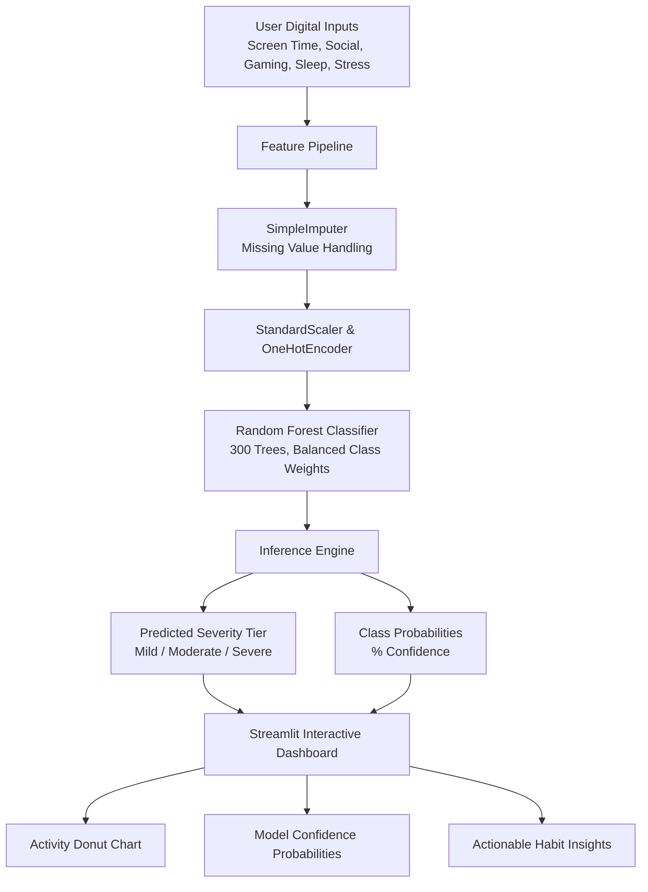

<div align="center">

# 📱 Smartphone Addiction Prediction

### *Machine Learning Prediction of Digital Habits, Psychological Stress, and Addiction Risk*

[](https://python.org)
[](https://streamlit.io)
[](https://scikit-learn.org)
[](https://plotly.com)
[](https://github.com/reet2712/Smartphone-Addiction-prediction)

</div>

---

## 📌 Project Overview

With modern smartphones serving as hubs for communication, entertainment, education, and work, excessive usage often leads to compulsive screen behavior and attention fragmentation. This project delivers an **interactive Machine Learning prediction web application** designed to:

1. **Predict smartphone addiction severity** (`Mild`, `Moderate`, `Severe`) using a trained **Random Forest** classification pipeline.
2. **Analyze daily screen usage** across discrete habit categories (Social Media, Gaming, Work/Study, Idle Screen Time).
3. **Benchmark individual metrics** against population distributions derived from an empirical dataset of **7,500 surveyed individuals**.
4. **Provide personalized habit insights** regarding sleep debt, notification frequency, and screen balance.

---

## ✨ Key Features & Interactive Capabilities

### 🎯 1. Interactive Assessment & Real-Time Prediction
- **Dynamic Persona Presets**: 1-click loading of archetypal usage personas (*Casual Social Scroller*, *Exam-Stressed Student*, *Hardcore Mobile Gamer*, *Balanced Minimalist*).
- **Multi-Class Confidence Distribution**: Horizontal bar charts displaying model probability across all risk tiers (`Mild`, `Moderate`, `Severe`).
- **Screen Time Donut Chart**: Proportional breakdown of Social Media, Mobile Gaming, Work/Study, and Other apps.
- **Actionable Habit Insights**: Dynamic recommendations addressing sleep duration, notification management, and focus balance.

### 📊 2. Exploratory Data Analytics (EDA)
- **Cohort Metrics**: Interactive metrics tracking median screen time, sleep duration, and severe addiction prevalence.
- **Distribution Visualizations**: Box plots and scatter distributions demonstrating correlations between screen time, sleep duration, and addiction tiers.
- **Correlation Heatmap**: Multi-variable Pearson correlation matrix mapping interdependencies across digital behaviors.
- **Cross-Tabulation**: Interactive examination of stress levels and academic/work impact across addiction classes.
- **Raw Data Viewer**: Filterable preview of survey records from the 7,500-sample dataset.

---

## 🏗️ Architecture & Pipeline Flow



---

## 📂 Project Repository Structure

```text
Smartphone-Addiction-prediction/
├── .streamlit/
│   └── config.toml                  # Streamlit visual theme & server parameters
├── .gitignore                       # Git ignored files & environments
├── requirements.txt                 # Exact dependencies for cloud deployment
├── streamlit_app.py                 # Interactive Streamlit Web Application
├── app.py                           # Application entrypoint wrapper
├── main.py                          # Legacy Flask prototype
├── Smartphone_Usage_And_Addiction_Analysis.csv        # 7,500-sample dataset
├── Smartphone_Usage_Classification_and_PKL_Download.ipynb # Model training & EDA notebook
├── smartphone_addiction_best_model.pkl                # Trained Random Forest pipeline
├── smartphone_addiction_feature_columns.pkl           # Feature schema order
├── smartphone_addiction_target_classes.pkl            # Target class labels
├── smartphone_addiction_model_metadata.pkl            # Model metadata & evaluation criteria
└── README.md                        # Documentation & deployment guide
```

---

## 🚀 Quickstart & Local Installation

### Prerequisites
- Python **3.10+** (Recommended: Python **3.11**)
- `git` version control

### 1. Clone the Repository
```bash
git clone https://github.com/reet2712/Smartphone-Addiction-prediction.git
cd Smartphone-Addiction-prediction
```

### 2. Create and Activate a Virtual Environment
```bash
# Windows
python -m venv .venv
.venv\Scripts\activate

# macOS / Linux
python3 -m venv .venv
source .venv/bin/activate
```

### 3. Install Required Dependencies
```bash
pip install -r requirements.txt
```

### 4. Launch the Streamlit Application
```bash
streamlit run streamlit_app.py
```
Open your browser at `http://localhost:8501` to interact with the application.

---

## 🌐 1-Click Streamlit Community Cloud Deployment

You can host this application online for free in under 2 minutes:

1. **Push Code to GitHub**:
   Ensure all files are committed and pushed to your GitHub repository:
   `https://github.com/reet2712/Smartphone-Addiction-prediction`

2. **Access Streamlit Cloud**:
   Navigate to [share.streamlit.io](https://share.streamlit.io) and sign in with your GitHub account (`reet2712`).

3. **Deploy New App**:
   - Click **"New app"** (or **"Create app"**).
   - In **Repository**, choose: `reet2712/Smartphone-Addiction-prediction`.
   - In **Branch**, select: `main`.
   - In **Main file path**, enter: `streamlit_app.py`.
   - Click **Deploy!**

---

## 🔬 Model Performance & Feature Space

The predictive model assesses 12 input features:

| Feature Name | Description | Type | Range / Domain |
|:---|:---|:---|:---|
| `age` | User chronological age | Numeric | 16 – 80 |
| `gender` | Identified gender category | Categorical | Female, Male, Other |
| `daily_screen_time_hours` | Active weekday screen hours | Numeric | 1.0 – 18.0 |
| `social_media_hours` | Hours on social & short-video apps | Numeric | 0.0 – 12.0 |
| `gaming_hours` | Mobile gaming engagement | Numeric | 0.0 – 10.0 |
| `work_study_hours` | Productive academic/work use | Numeric | 0.0 – 12.0 |
| `sleep_hours` | Average nightly sleep | Numeric | 2.0 – 12.0 |
| `notifications_per_day` | Total daily push notifications | Numeric | 10 – 800 |
| `app_opens_per_day` | Phone pick-ups & unlocks per day | Numeric | 10 – 500 |
| `weekend_screen_time` | Average daily weekend screen hours | Numeric | 1.0 – 20.0 |
| `stress_level` | Self-reported stress indicator | Categorical | Low, Medium, High |
| `academic_work_impact` | Work or study degradation | Categorical | Yes, No |

### Model Benchmark Summary
- **Random Forest Classifier**: Selected for highest Macro F1 and generalization capability across imbalanced classes (`Mild`, `Moderate`, `Severe`).
- **Pipeline Integration**: Imputation, scaling, and one-hot encoding are bundled directly within the pipeline artifact to ensure 100% feature consistency at inference time.

---

## 👤 Author & Acknowledgments

- **Developer & Researcher**: [Reet Advani](https://github.com/reet2712)
- **Repository**: [https://github.com/reet2712/Smartphone-Addiction-prediction](https://github.com/reet2712/Smartphone-Addiction-prediction)
- **License**: MIT Open Source

---